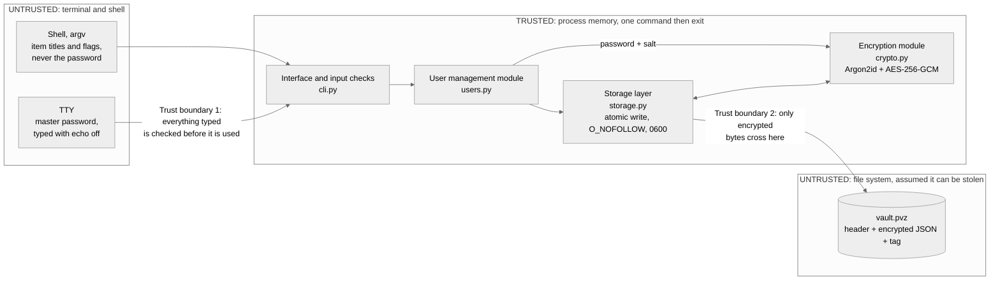

# Secure Password Manager (pwvault)

Repository: https://github.com/sebasp-9/ICS0022

ICS0022 Secure Programming, Checkpoint 1. Sebastian Parra Pinto

## 1. Scope

pwvault is an offline command line password manager for a single user. Each item is one
saved login with a title, a login name and a password, the same as in the ICS0027 web
application. The whole vault is kept in one encrypted file on the local disk and one master
password opens it. There is no network listener, no server and no background process.

Sharing, password history, sync between machines and account recovery are out of scope. A
forgotten master password cannot be recovered, because the key is derived from it and no
other copy of it exists.

## 2. System architecture

| Module | File | Responsibility |
| --- | --- | --- |
| User management | `users.py` | Unlock and lock the vault; create, view, edit and delete items |
| Encryption module | `crypto.py` | Argon2id key derivation, AES-256-GCM encryption and decryption |
| Storage layer | `storage.py` | Reading and writing the vault file safely |

The terminal asks for the master password with a masked prompt and passes it to the user
management module. That module reads the file through the storage layer, then gives the
password and the salt from the header to the encryption module, which derives the key and
decrypts the payload. The vault is a normal dictionary in memory for the duration of the
command. Any change is encrypted again and written back. The process exits after the command.
Python cannot guarantee erasure of keys or decrypted strings from memory.

**Trust boundary 1 (terminal to program).** Everything arriving on argv or stdin is
attacker input until it has been checked, so the master password is never a command
argument.

**Trust boundary 2 (program to file system).** The vault file is treated as something that
could be stolen or modified, so only encrypted bytes cross it. The storage layer never sees
the password, the key or the decrypted items.

## 3. Cryptographic design and vault format

**Key derivation.** The master password is processed with a distinct 16 byte random salt
using Argon2id (64 MiB memory cost, time cost 3, parallelism 4) to derive one 256 bit key.
Argon2id is chosen over the other Argon2 variants because it resists both GPU and ASIC
parallelisation and side channel attacks. The salt and the cost settings are stored in the
header so that they can be increased later.

**Encryption.** The vault is serialised to JSON and encrypted with AES-256-GCM. A distinct
96 bit nonce is generated for every write, and a 128 bit authentication tag is verified on
every read, which also detects if the encrypted data has been changed. The plaintext header
is supplied as associated data, so the salt and the Argon2 settings are covered by the tag
and cannot be weakened.

**Checking the master password.** No password hash is stored. A wrong password derives a
wrong key, and then the tag verification fails. The ICS0027 web application does store a
`password_hash`, because a server has to authenticate the user before it can derive
anything. Here there is no server, so the tag is enough.

| Size | Field |
| --- | --- |
| 6 bytes | Magic header `PVLT01` |
| 1 byte | Format version number |
| 6 bytes | Argon2 settings (memory cost, time cost, parallelism) |
| 16 bytes | Argon2id KDF salt |
| 12 bytes | AES-256-GCM nonce |
| Variable | AES-256-GCM encrypted JSON payload |
| 16 bytes | AES-256-GCM authentication tag |

The whole vault is encrypted as one block instead of one item at a time, so the titles and
the login names do not stay readable in the file. A stolen copy shows only the file size
and the Argon2 settings.

## 4. Threat model

| # | Target | Threat | Week | Planned mitigation |
| --- | --- | --- | --- | --- |
| T1 | Master password | Leaks through the shell history or process listings (`ps`), because it was passed as an argument | W3 | Never accepted as an argument or an environment variable. Read only through a masked, unechoed prompt (`getpass`). |
| T2 | Master password | Offline brute force against a stolen vault file | W2 | Argon2id at 64 MiB memory cost and time cost 3, with a random salt per vault, so GPU attacks are slow. |
| T3 | Vault at rest | Someone with file access changes the encrypted data or the header | W2 | AES-256-GCM, with the header as associated data. Any change fails tag verification and the program stops. |
| T4 | Vault at rest | The vault path is replaced with a symbolic link, so saving overwrites another file | W3 | Open with `O_NOFOLLOW` and check the file that was opened: a regular file, owned by the user, mode `0600`. |
| T5 | Vault at rest | A crash while saving leaves a broken vault | W3 | Write to a temporary file in the same directory and rename it over the vault, which is atomic. |
| T6 | Vault in memory | A memory dump, swap file or core dump exposes the key | W2 | Keep each process short-lived. Reliable memory erasure and operating-system hardening are not implemented in checkpoint 2. |
| T7 | Vault in memory | A long running process keeps the vault decrypted for hours | W2 | Every command is its own short lived process. There is no background agent, so plaintext exists only for the command, including its input prompts. |
| T8 | Interface | Format string injection, where `{x.__init__.__globals__}` reaches the key and the decrypted vault | W4 | Never call `.format()` or `%` on text that came from the user, and never evaluate it as an f-string. |
| T9 | Interface | Control characters or ANSI escapes in a field affect the terminal when printed | W4 | Check every field against an allow list of characters and reject anything else. |
| T10 | Interface | A password stays in the clipboard or in the terminal scrollback | W4 | Checkpoint 2 never prints passwords and has no --show option. Clipboard retrieval is planned for checkpoint 3. |

Out of scope: a compromised operating system, a root user, a keylogger, and an attacker at
an already unlocked machine. A remaining risk is rollback, because an old copy of the vault
file still decrypts correctly. Detecting that needs a record kept outside the file, which is
left for a later checkpoint.

## 5. Technology

Python 3.12, because it manages memory automatically and it matches the web application
built for ICS0027. The main risk in a password manager is using cryptography incorrectly
rather than memory corruption, and Python removes buffer overflows completely. The drawback
is that it cannot reliably erase a string from memory, which remains a limitation; the implementation limits
plaintext lifetime by exiting after each command.

* **cryptography**: OpenSSL C bindings for AES-256-GCM, which handles authenticated
  encryption natively.
* **argon2-cffi**: C level Argon2id key derivation, so there is no manual memory handling.
* **getpass and argparse**: standard library modules for masked password input and command
  line argument parsing.

The planned commands and the build and run instructions are in the repository README.

## 6. Checkpoint 2 implementation

The basic commands are now implemented. The README describes the actual
interface; generation, clipboard support and changing the master password remain
planned. Passwords are never printed, including by get. No --show option is
implemented because checkpoint 2 explicitly forbids cleartext password output.

Docker is the recommended setup. It provides a Linux terminal, a non-root user,
and a named volume for the vault. There is no server or database. Each command
starts a new process and exits after it finishes.

The storage code enforces private file permissions and owner checks on POSIX.
On Windows, it inherits the user's folder permissions instead; Docker provides
the intended POSIX environment. Symbolic/reparse and hard-linked vault files are
rejected. Existing vaults are replaced with os.replace after a complete
temporary file has been written and flushed. New files are published without
overwriting an existing target (rename on Windows, link on POSIX).

The header's six bytes of Argon2 settings are a four-byte memory cost and
one byte each for time and parallelism, in network byte order. Unsupported
settings are rejected before key derivation, so a modified file cannot request
arbitrary amounts of memory.

AES-GCM authentication failure cannot tell a wrong master password from
changed ciphertext, so both return exit code 2 with the same message.
The original plan's separate modified-vault exit code applies only to invalid
headers, size, structure or file access checks.

Remaining limitations: one writer at a time, no rollback detection, no guaranteed
secret-memory erasure and no recovery for a forgotten master password.
See PROGRESS.md for validation results, including the successful Docker build and checks.
