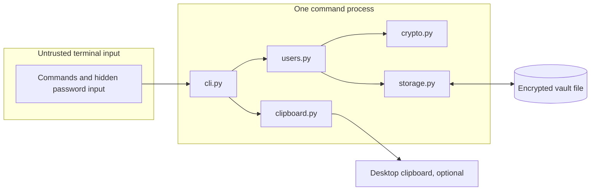

# Design and threat model

## Scope

The application is an offline CLI for one encrypted vault per OS user.
Each saved login has a title, a login name and a password. Every command
authenticates before accessing records. Account sharing, synchronization
and password recovery are outside the scope.

## Architecture

The CLI reads input. users.py validates fields and coordinates create,
open and save. crypto.py derives keys and authenticates encrypted data.
storage.py handles private file access and atomic replacement. Only encrypted
vault bytes cross into storage. Optional get --copy sends one password to
the desktop clipboard; keys are not copied there.

Supporting modules are small: audit.py writes fixed event metadata,
locking.py allows one command at a time, and memory.py handles owned-buffer
cleanup and Linux dump restrictions. The report explains these controls.
clipboard.py copies for 20 seconds and clears only matching clipboard text.

## Cryptographic format

Argon2id derives a 256-bit key using a random 16-byte salt, 64 MiB memory,
three iterations and parallelism four. AES-256-GCM encrypts the whole JSON
vault with a fresh 12-byte nonce per save. The header is authenticated too.
The master password is not stored; tag verification authenticates the
derived key. A wrong password and modified ciphertext share one error.

The file contains a 41-byte header, encrypted JSON and a 16-byte tag.
The header stores magic/version, supported KDF parameters, salt and nonce.
Unsupported parameters and files over 2 MiB are rejected before decryption.

## Threat model

| Threat | Control |
|---|---|
| Password exposed in shell history/output | Hidden prompts; passwords never accepted in argv or printed |
| Stolen vault | Salted Argon2id and whole-vault AES-GCM; strong master password still necessary |
| Modified ciphertext/header | Authentication tag checked before parsing records |
| Malformed fields or terminal control characters | Type, length, printable-text and schema checks |
| File redirected through links or owned by another user | Linux directory handles, no-follow opens and ownership/permission checks |
| Failed save or concurrent command | Private temporary file, atomic publication and OS command lock |
| Secrets retained in memory | Owned buffers wiped in cleanup paths; short-lived commands and Linux dump restrictions |
| Secrets leaked through logs/errors | Fixed event fields and controlled error messages |
| Clipboard exposure | Optional copy; 20-second cleanup; history/sync and other apps can retain copies |

## Boundaries and limitations

The terminal and filesystem are untrusted boundaries. Root, malicious
processes already running as the vault owner and a compromised OS remain
outside the protection model. OS-user ownership applies to the whole vault;
there are no separate application accounts or shared records.

Python strings and native libraries may retain copies that cannot be wiped
reliably. The program does not detect rollback to an older valid vault or
erase backups/old disk blocks on deletion. Windows has weaker path/race
guarantees than the intended Docker/Linux environment. A shared Docker
volume under one UID is one identity, not a separate account per person.

Clipboard retrieval requires a local desktop; the Docker image is headless.
Clearing cannot erase clipboard history or guarantee cleanup after a forced
process kill. The real clipboard check covers Windows; other desktop
backends have not been exercised here.
